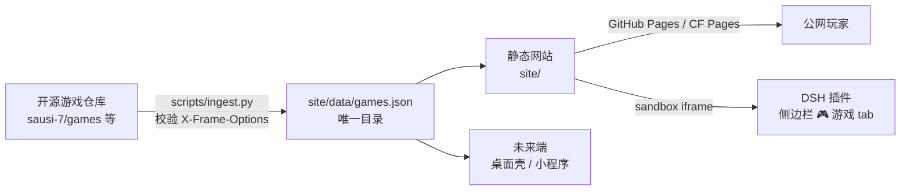

# 🎮 GameHub Arcade for DeepSeek Harness

<p align="center">
  <strong>1000+ 经典网页游戏 · 即点即玩 · 无需安装 · DSH 侧边栏一键直达</strong><br>
  <em>1000+ classic browser games in your DeepSeek Harness sidebar. Zero installs.</em>
</p>

<p align="center">
<a href="https://github.com/bihong2026/dsh-arcade/stargazers"></a>
<a href="https://github.com/bihong2026/dsh-arcade/network/members"></a>


</p>

<p align="center">
简体中文 · <a href="README.en.md">English</a>
</p>

---

## ✨ 这是什么

**GameHub Arcade** 是一个 [DeepSeek Harness](https://github.com/deepseek-ai/deepseek-harness) 插件。安装后，DSH Web 界面侧边栏会多出一个 **🎮 游戏** 标签，点开就是完整的游戏中心：

- 🕹️ **26+ 上线游戏，持续扩充**：贪吃蛇、2048、俄罗斯方块、吃豆人、扫雷、围棋、Hextris……全部来自开源社区（MIT 等），逐个验证可嵌入、可实际运行后收录
- ⚡ **即点即玩**：游戏在沙箱 iframe 中运行，不装任何本地依赖
- 🔍 **搜索 / 分类 / 收藏 / 随机**：棋盘游戏、街机、益智、3D 等 10 大分类
- 🌓 **明暗主题**：跟随系统，护眼
- 🔒 **安全沙箱**：不授予 same-origin，游戏无法访问 DSH 数据
- 🧩 **持续扩展**：目录是纯 JSON，一条记录 = 一个新游戏（见 [收录新游戏](#-收录新游戏)）

同时包含一个可独立部署的**游戏网站**（GitHub Pages / Cloudflare Pages 皆可），插件只是把同一个网站嵌入侧边栏——一个目录，两个入口，流量共享。

## 📦 安装

在 DeepSeek Harness 终端中执行：

```bash
# 推荐固定版本
dsh plugin --profile web add github:bihong2026/dsh-arcade#v0.1.0

# 或跟踪 main 分支
dsh plugin --profile web add github:bihong2026/dsh-arcade#main
```

重启 `dsh web` 并刷新页面，侧边栏即出现 **🎮 游戏** 标签。

## 🗂️ 目录结构

```
dsh-arcade/
├── package.json        # DSH 插件清单（dsh.client / keywords / exports）
├── cordis.patch.yml    # DSH bundle 挂载配置
├── build.mjs           # esbuild：client bundle（react external + ModuleLoader 包装）
├── lib/                # 构建产物（安装即用，无需本地构建）
├── src/                # 插件源码（host 入口 + client 侧边栏注册）
├── site/               # 游戏网站（可独立部署到 GitHub Pages / Cloudflare Pages）
│   ├── index.html      # 启动页：搜索、分类、收藏、随机、播放器
│   ├── assets/         # 站点样式与逻辑（CSS 变量主题，支持插件紧凑模式）
│   └── data/games.json # ⭐ 游戏目录（唯一数据源，site 与 plugin 共用）
├── scripts/ingest.py   # 收录管线：拉取上游 registry → 校验可嵌入性 → 生成目录
└── docs/               # 架构与贡献指南
```

## 🏗️ 架构



设计原则：

1. **目录即数据**：`games.json` 是唯一事实来源，网站与插件都只读它；加游戏零代码改动
2. **收录即验证**：ingest 管线自动检查每个游戏 URL 的 `X-Frame-Options` / `CSP frame-ancestors`，不可嵌入的游戏不会进入目录
3. **插件薄壳**：插件只负责侧边栏标签 + 沙箱 iframe，游戏逻辑与 UI 全在网站侧，插件永远不用为新增游戏发版

## ➕ 收录新游戏

**方式一：编辑目录（最快）** — 在 `site/data/games.json` 的 `games` 数组追加：

```json
{
  "id": "manual:my-game",
  "slug": "my-game",
  "name": "我的游戏",
  "category": "puzzle",
  "tags": ["classic"],
  "description": "一句话介绍",
  "tech": "html5",
  "embed": "https://<game-url>",
  "embed_ok": true,
  "source_repo": "https://github.com/...",
  "license": "MIT"
}
```

**方式二：跑收录管线（批量）**

```bash
python3 scripts/ingest.py        # 拉取全部 registry 源并校验，重建目录
```

收录标准：可 iframe 嵌入、无强制广告/跳转、开源或已获授权、内容健康。

> ⚠️ 版权说明：每个游戏的版权与许可归其上游作者，条目中的 `source_repo` / `license` 字段用于溯源。收到上游作者的移除请求会立即处理。

## 🚀 部署独立网站（可选）

```bash
# GitHub Pages：仓库设置中把 site/ 设为 Pages 源，或用 gh-pages 分支
# Cloudflare Pages：构建命令留空，输出目录填 site/
python3 -m http.server 8080 --directory site   # 本地预览
```

## 🔖 插件市场与 SEO

- `package.json` 的 `keywords` 覆盖 `dsh / deepseek-harness / dsh-plugin / games / arcade / sidebar / entertainment`，可被插件目录与 GitHub topic 检索
- 建议给仓库加 GitHub topics：`deepseek-harness` `dsh-plugin` `browser-games` `html5-games` `mini-games` `sidebar`
- 站点已内置 `description` meta 与 emoji favicon；上线后建议补充 sitemap 与 OG 图

## 🗺️ Roadmap

- [x] 插件骨架 + 侧边栏标签 + 沙箱播放器
- [x] 目录管线与可嵌入性校验
- [x] 网站启动页（搜索/分类/收藏/随机/全屏）
- [ ] 26 → 1000+ 游戏扩充（持续跑 ingest，欢迎 PR）
- [ ] 游戏排行榜（localStorage 起步，后端可选）
- [ ] 中英文目录元数据
- [ ] DSH 主题色适配（读取 --dsw-* tokens）

## 🤝 贡献

欢迎 PR 收录新游戏、修复失效链接、改进 UI。收录前请跑 `python3 scripts/ingest.py` 确认新游戏通过可嵌入性校验。

## 📄 License

本仓库代码 MIT。收录的第三方游戏各自遵循其上游许可证，详见 `games.json` 中的 `license` 字段。

<p align="center">
<em>如果觉得有用，点个 ⭐ 让更多 DSH 用户发现它！</em>
</p>
